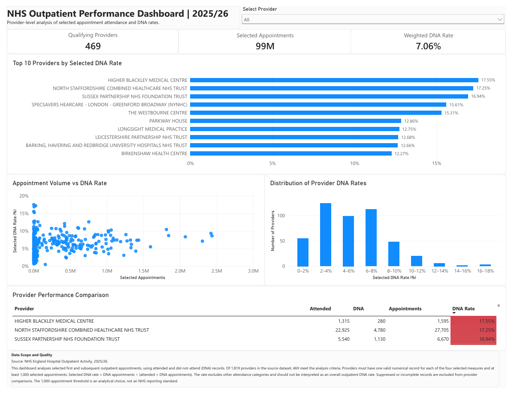

# NHS Outpatient Attendance and DNA Performance Analysis

## Project Overview

This project analyses NHS England outpatient attendance and did-not-attend (DNA) activity for the 2025/26 reporting period.

The aim was to calculate provider-level DNA rates, investigate variation between providers and present the results through an interactive Power BI dashboard.

## Tools Used

- Microsoft Excel: Data exploration, pivot tables and initial calculations
- SQLite: Data filtering, aggregation and validation
- Power BI: Interactive dashboard and DAX measures

## Dataset

The NHS England outpatient activity dataset contains:

- 55,845 source records
- 1,819 distinct provider codes
- Attendance activity measures for the 2025/26 reporting period

The analysis focuses on four selected attendance measures.

## Methodology

1. Explored the original dataset in Excel.
2. Identified suppressed values and incomplete provider records.
3. Selected first and subsequent appointments attended and missed.
4. Calculated provider-level DNA rates using SQL.
5. Included providers with four valid measures and at least 1,000 selected appointments.
6. Validated the qualifying-provider count and Top 10 rankings against Excel.
7. Developed an interactive Power BI dashboard.

## Key Findings

- 469 providers met the analysis criteria.
- The weighted selected DNA rate was 7.06%.
- Approximately 99 million selected appointments were included.
- Higher Blackley Medical Centre had the highest selected DNA rate among qualifying providers, at 17.55%.

## Dashboard

The Power BI dashboard includes:

- KPI cards
- Top 10 providers by selected DNA rate
- Appointment volume versus DNA rate scatter chart
- DNA rate distribution
- Searchable provider comparison table

### Dashboard Preview

The interactive Power BI report is available in [`04_power_bi/nhs_outpatient_dashboard.pbix`](04_power_bi/nhs_outpatient_dashboard.pbix).

## Limitations

This analysis uses four selected attendance measures and does not represent the overall NHS outpatient DNA rate.

Suppressed values were excluded rather than treated as zero. The 1,000-appointment threshold was an analytical decision, not an official NHS threshold.

An Excel data-quality audit classification discrepancy affecting 144 excluded providers remains unresolved. The qualifying-provider count and Top 10 rankings were independently validated using SQLite.

Provider-level differences do not establish the reasons for missed appointments.

## Project Files

- `01_raw_data/`: Original NHS outpatient activity dataset and supporting metadata.
- `02_excel_analysis/`: Excel exploration, calculations and data-quality checks.
  - `nhs_outpatient_excel_analysis.xlsx`

- `03_sql/`: SQLite database and SQL analysis.
  - `nhs_outpatient_analysis.db`
  - `provider_dna_analysis.sql`

- `04_power_bi/`: Interactive Power BI dashboard.
  - `nhs_outpatient_dashboard.pbix`

- `05_outputs/`: Exported analysis results and dashboard screenshot.
  - `nhs_provider_dna_analysis.csv`
  - `nhs_outpatient_dashboard.png`

- `06_documentation/`: Project report, methodology and data-quality documentation.
  - `nhs_outpatient_analysis_report.pdf`: Complete project report covering the dataset, cleaning, SQL analysis, validation, visualisation, findings and limitations.
  - `methodology.md`: Explanation of the calculations and provider inclusion criteria.
  - `data_quality_notes.md`: Data-quality checks, validation results and outstanding limitations.

The `README.md` file is located in the main `nhs_outpatient_dna_analysis/` folder.

## Data Source

NHS England, Hospital Outpatient Activity, 2025/26.